

  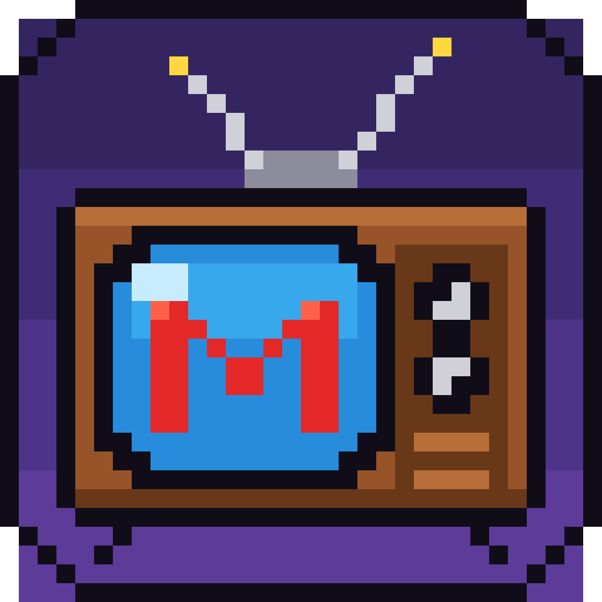

<h1 align="center">Mad TV Upscaled</h1>

  <b>Play the 1991 TV station manager Mad TV on a modern Mac or Windows PC, natively, with every picture upscaled 6x.</b> 
  Free and open source. Bring your own copy of the game.

  <a href="https://github.com/007hacky007/mad-tv-upscaled/releases/latest"><b>Download the latest version</b></a>
  &nbsp;·&nbsp;
  <a href="#getting-started">Getting started</a>
  &nbsp;·&nbsp;
  <a href="#what-you-need">What you need</a>
  &nbsp;·&nbsp;
  <a href="#questions">Questions</a>
  &nbsp;·&nbsp;
  <a href="#deutsch">Deutsch</a>

  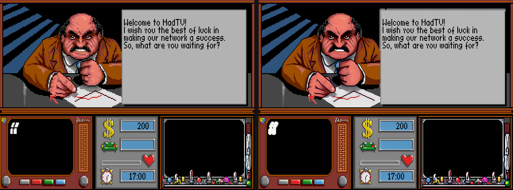
   Same scene, same moment. The original 320x200 on the left, upscaled on the right.

> [!IMPORTANT]
> The game itself is not included. You need your own copy of the original DOS
> release of Mad TV (Rainbow Arts, 1991). The app reads your files and builds the
> port on your computer; without them it does nothing.

## What it is

Mad TV was made for DOS, at 320x200 with 256 colours. This project runs the
original game natively on Macs with Apple silicon and on Windows 10 and 11, no
DOSBox needed:

- **The original game, exactly.** The game's own program is translated
  instruction by instruction and runs as it did in 1991: the same rooms, the same
  ratings, the same boss, the same Betty.
- **Upscaled pictures.** Every picture of the game is enlarged six times by an AI
  upscaler (Real-ESRGAN) on your own computer. Text, people, rooms and the
  building keep their look, only sharper.
- **The AdLib music,** played by an emulated sound chip.
- **English and German,** both from the original release. Switch in the options
  (**F12**); your game stays where it is.
- **F11** (or Alt+Enter) switches fullscreen. **F12** opens the options:
  language, 4:3 or square pixels, fullscreen.
- **Pause** switches between the upscaled pictures and the original pixels.
- **F1 to F10** are the game's own keys, as in the original.
- **Saves** stay in the game's own format, ten slots in the office safe.

| The title | The building |
| --- | --- |
| 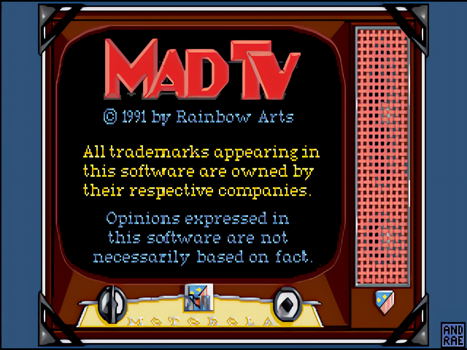 | 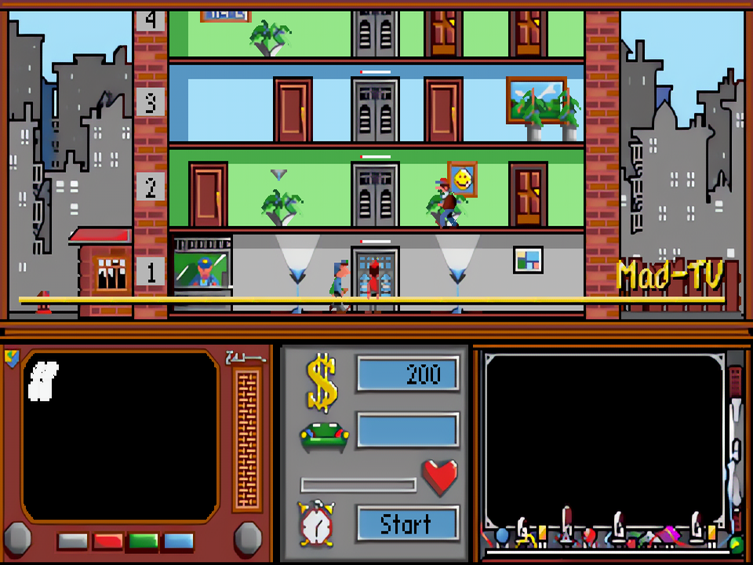 |
| **The boss** | **The laboratory** |
| 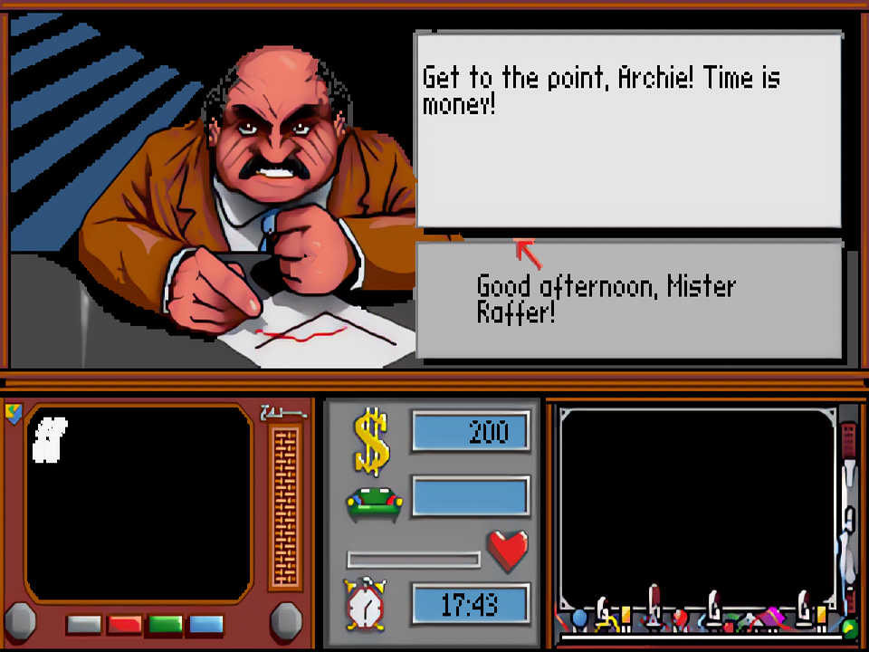 | 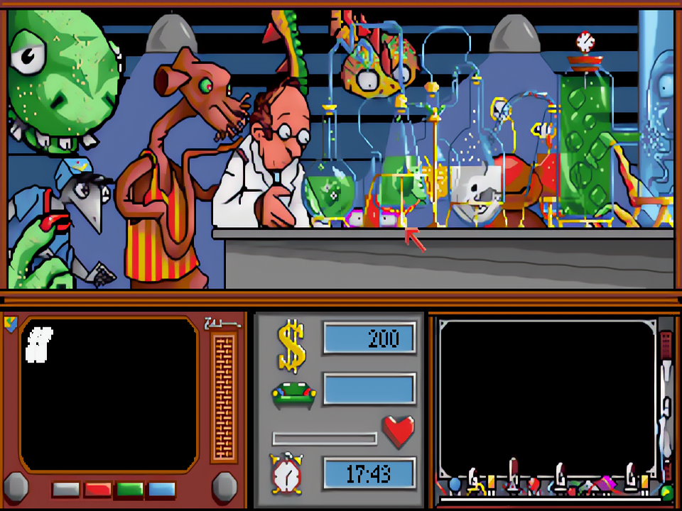 |
| **The desert** | **The consulate** |
| 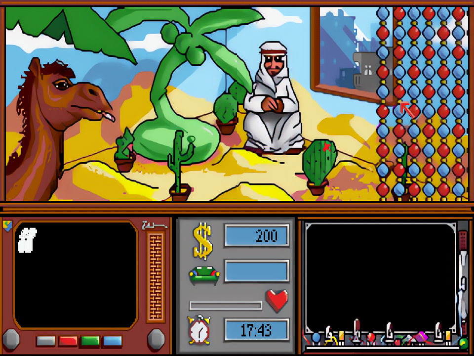 | 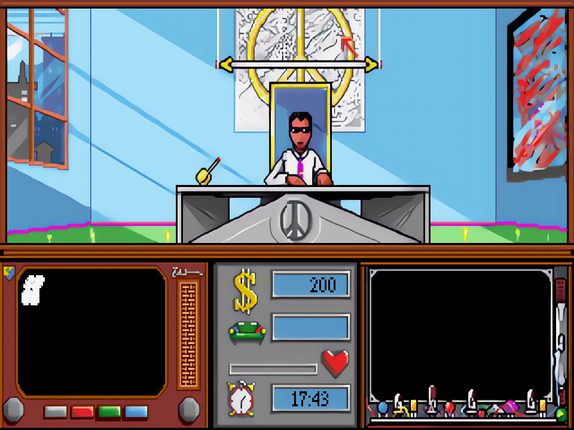 |
| **A party** | **The porter** |
| 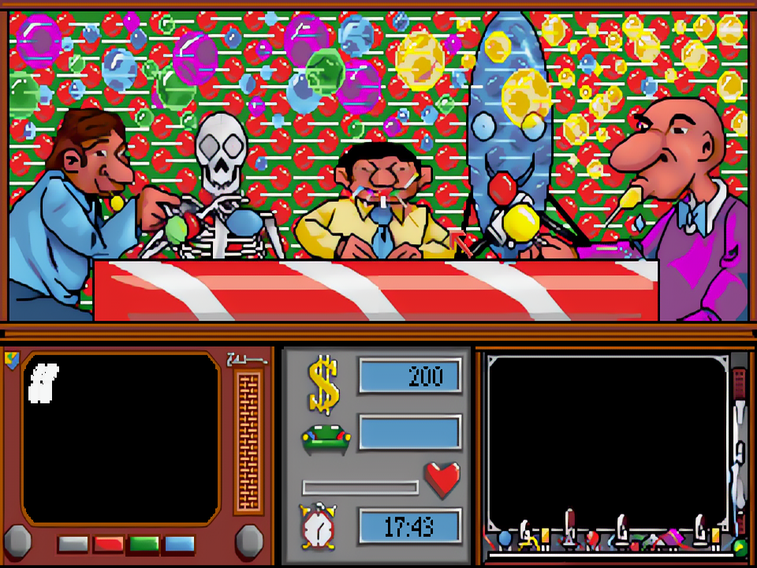 | 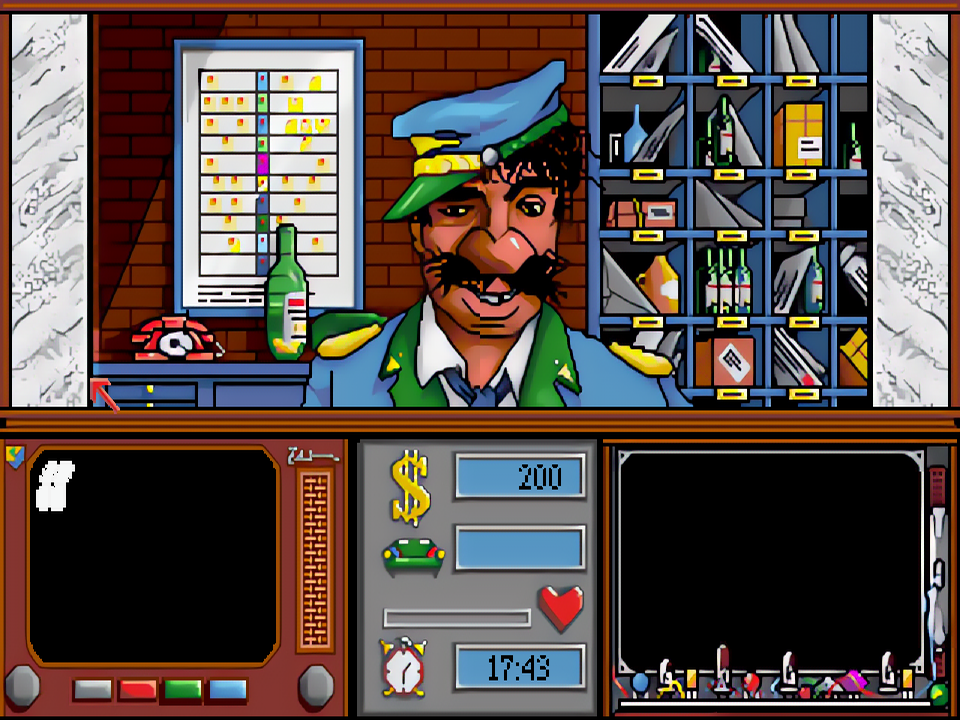 |

## Getting started

1. **Download** the app for your computer from the
   [latest release](https://github.com/007hacky007/mad-tv-upscaled/releases/latest):
   - Mac: `MadTV-macOS.dmg`
   - Windows: `MadTV-Windows.zip`
2. **Install and open it.**
   - **Mac:** open the disk image and drag *MadTV* to *Applications*, then open
     it from there. It is not signed by Apple, so the first time macOS refuses to
     open it. The disk image window shows what to do: click *Done*, open *System
     Settings > Privacy & Security*, scroll down and click *Open Anyway*.
   - **Windows:** unpack the zip and run *mtv.exe* in the *MadTV-win64* folder. If
     SmartScreen says "Windows protected your PC", click *More info* and then
     *Run anyway*.
3. **Choose the folder with your game files.** The app checks them against the
   original release and copies them into your user folder. Your originals stay
   untouched.
4. **Wait a moment.** The app unlocks the game with your files and upscales all
   1185 pictures. That takes under a minute on an M1 Pro, a few minutes with a
   slower graphics card. **Esc** skips it: you play with plain enlarged pixels
   and can build the pictures later from the options (**F12**).
5. **Play.** Later starts go straight to the game. Playing needs no internet
   connection.

  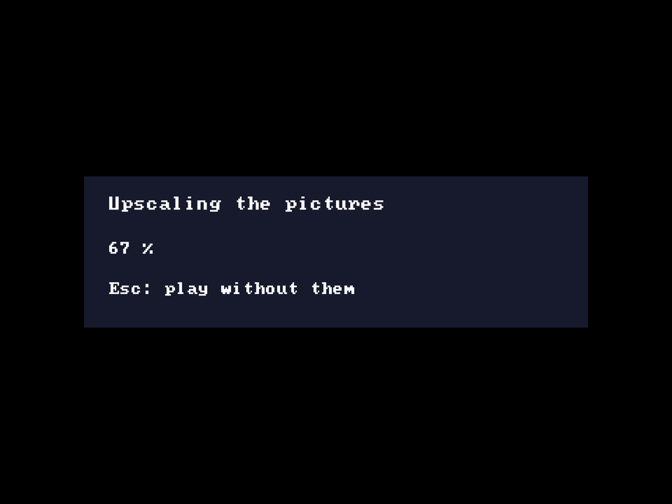

## What you need

| | Mac | Windows |
| --- | --- | --- |
| System | macOS 13 or newer, Apple silicon (M1 or later) | Windows 10 or 11, 64-bit |
| Graphics for the upscaling | Built in, nothing to install | A graphics card with an up-to-date driver (Vulkan) |
| Free disk space | About 200 MB | Same |
| Time on the first start | Under a minute on an M1 Pro | A few minutes, depending on the graphics card |

**Your game files.** The app recognises the English/German DOS release of Mad TV
by its six files: `MTV.EXE`, `SOURCE1.RSC`, `SOURCE2.RSC`, `INTRO.EXE`, `MCV.BIN`
and `DATAV.PCK`. Copy them from your floppy disks or from your old installation
into one folder.

Without a graphics card that supports Vulkan the game still runs, with plain
enlarged pixels instead of the upscaled pictures.

## Questions

**Is the game included?** No. Nothing from the original game is in the download
or in this repository. The app reads it from your files, on your computer.

**Why is part of the download locked?** The game's program, translated for
today's computers, ships encrypted. The key is made from your own `MTV.EXE` and
`SOURCE1.RSC`, so the download is useless to anyone without the game.

**It says my files are the wrong release.** Only the release we could test is
supported so far. If you have a different one, open an
[issue](https://github.com/007hacky007/mad-tv-upscaled/issues) with the message
the app shows.

**Where are my saved games?** On a Mac in
`~/Library/Application Support/MadTV`, on Windows in `%APPDATA%\MadTV`. They use
the game's own format, inside its copy of `SOURCE1.RSC`.

**Can I switch back to the original look?** Yes, press **Pause** while playing to
switch between the upscaled pictures and the original pixels.

**Can I copy the finished game to another computer?** Copy the app and your game
files, and let the app set itself up there. Please do not upload your user folder
anywhere: it contains the original game.

## Deutsch

Mad TV Upscaled bringt die Fernsehsender-Simulation Mad TV (Rainbow Arts, 1991)
nativ auf Macs mit Apple silicon und auf Windows 10/11, mit sechsfach
hochskalierten Bildern. Das Spiel selbst ist nicht enthalten. Lade die App für
deinen Computer aus der
[neuesten Version](https://github.com/007hacky007/mad-tv-upscaled/releases/latest),
starte sie und wähle den Ordner mit deinen Originaldateien (`MTV.EXE`,
`SOURCE1.RSC`, `SOURCE2.RSC`, `INTRO.EXE`, `MCV.BIN`, `DATAV.PCK`). Die App prüft
und kopiert sie, entsperrt damit das Spiel und skaliert alle Bilder auf deinem
Rechner hoch. **F12** öffnet die Optionen (Sprache Deutsch/Englisch, Bildformat,
Vollbild), **F11** schaltet auf Vollbild. Auf dem Mac öffnest du die App beim
ersten Mal über *Systemeinstellungen > Datenschutz & Sicherheit > Dennoch öffnen*,
unter Windows über *Weitere Informationen > Trotzdem ausführen*. Auf dem Mac
ziehst du MadTV aus dem Disk-Image in den Ordner *Programme*.

## For developers

How to build from source and how the packages are made: [docs/build.md](docs/build.md).
What has been verified: [docs/delivery.md](docs/delivery.md). A build needs the
original files: the game's program is translated from them at build time, and
nothing generated from them is committed.

## License

The port is free software under the GPLv3, see [LICENSE](LICENSE). Third-party
components keep their own licenses, see
[THIRD_PARTY_NOTICES.md](THIRD_PARTY_NOTICES.md).

Mad TV and its original files belong to their respective rights holders and are
not part of this project.
